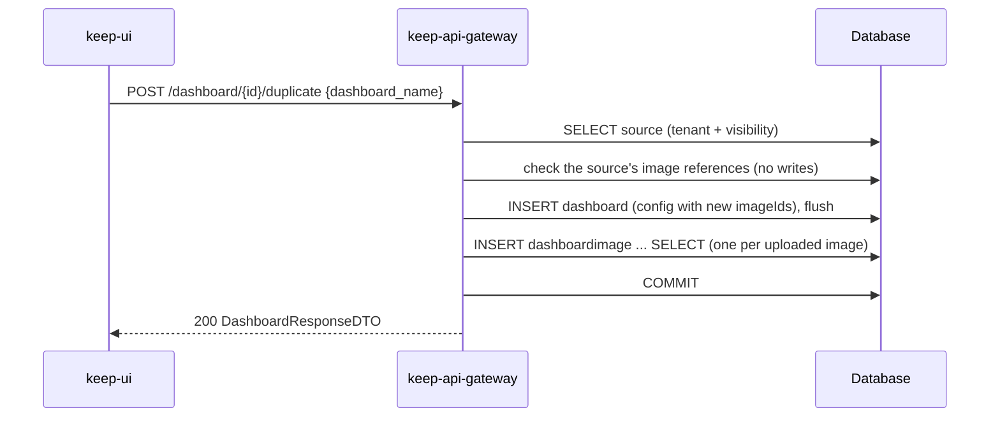

# Duplicate a dashboard

A user can copy an existing dashboard into a new one and change the copy freely.
The copy has the same widgets, layout and appearance, and gets its **own** copy
of every uploaded image. It came from a user feature request: start new dashboards
from an existing one instead of a blank page.

It ships in two repos, which must merge together, **gateway first**:

| Repo | What changed |
|---|---|
| `keep-api-gateway` | new endpoint `POST /dashboard/{dashboard_id}/duplicate` |
| `keep-ui` | copy icon on hover in the sidebar's Dashboards list, and the duplicate dialog |

There is no schema change, no `keep-migrations` change, and no new environment
variable or feature flag.

Related documents in this folder:

- Spec: [`superpowers/specs/2026-11-16-dashboard-duplicate-design.md`](superpowers/specs/2026-11-16-dashboard-duplicate-design.md) (the binding requirements)
- Plan: [`superpowers/plans/2026-11-16-dashboard-duplicate.md`](superpowers/plans/2026-11-16-dashboard-duplicate.md) (how it was split into tasks)

## How it works for the user

1. Hover a dashboard in the sidebar. A gray copy icon appears next to the trash icon.
   It turns orange under the pointer, with a "Duplicate" tooltip. Keyboard focus on the
   row shows it too.
2. Click it. The dialog "Duplicate dashboard" suggests `<name> (copy)`, or
   `(copy 2)`, `(copy 3)`… when that name is taken.
3. Press Duplicate or Enter. The copy is saved, the sidebar lists it, and the user
   lands on it in view mode with a "Dashboard duplicated" toast.

Nothing is added to the dashboard page itself. Duplicating is an occasional
action, so it deliberately adds no visual weight to the screen teams keep open.

The dialog's rules:

- **Name.** It is checked as you type. The Duplicate button is disabled while the
  trimmed name is empty, or matches an existing dashboard name (case ignored).
- **Unsaved edits.** Only the **saved** version is copied. If the dashboard being
  copied is open with unsaved edits, the dialog says "Unsaved changes aren't
  included in the copy."
- **Leaving with unsaved edits.** If the user is editing a dashboard with unsaved
  changes, the existing unsaved-changes prompt runs before navigating. If they stay,
  the copy still exists in the sidebar.
- **Errors.**
  - 409 (the name was taken meanwhile): inline "A dashboard with this name already
    exists", and the dialog stays open.
  - 404 (the source was deleted meanwhile): inline "This dashboard no longer exists",
    and the list refreshes.
  - Anything else: an error toast.
- **Cancel while saving.** If the dialog is closed before the request finishes, a
  late success only shows the toast. It neither navigates nor closes another
  dialog, and a late error is ignored.

## API

```
POST /dashboard/{dashboard_id}/duplicate
Scope: write:dashboards
Body:  { "dashboard_name": "NOC Overview (copy)" }
```

| Status | When | Body |
|---|---|---|
| 200 | Copy created | `DashboardResponseDTO`, same as `POST /dashboard` |
| 400 | The source references an image it doesn't own (inconsistent data) | `{"message": "Dashboard references missing or unavailable images", "invalid_image_ids": [...]}` |
| 403 | Missing `write:dashboards`, or read-only mode | standard |
| 404 | Source missing, in another tenant, or private and not created by the caller | `{"detail": "Dashboard not found"}` |
| 409 | `dashboard_name` already exists in the tenant | `{"detail": "A dashboard with this name already exists"}` |
| 422 | `dashboard_name` missing or empty after trimming | standard validation error |

The client sends only the name. The server copies the **saved** config, so a stale
or tampered client copy cannot get in. The name is trimmed.

The copy's metadata:

- `created_by` and `updated_by`: the caller
- `created_at` and `updated_at`: now
- `is_private`: taken from the source, so a copy is never more visible than its original

On success the gateway logs `Duplicated dashboard` at INFO, with `tenant_id`,
`source_dashboard_id`, `new_dashboard_id` and `copied_images`.

## Uploaded images

Every `dashboardimage` row belongs to exactly one dashboard. A save that
references an image owned by another dashboard is rejected, and deleting a
dashboard deletes its images. A copy therefore cannot reuse the source's image
ids. Copying the dashboard in the browser alone would fail with a 400.

The gateway does the whole copy in **one transaction** (`duplicate_dashboard` in
`src/repositories/db.py`):



Step by step:

- **Parse.** `get_dashboards` already handles a config stored as a JSON string; the
  same parsing is applied here.
- **Rewrite ids.** `rewrite_image_ids` (in `src/repositories/dashboard_images.py`)
  deep-copies the config and swaps each upload IMAGE widget's `imageId` for a new id.
  URL images, HTML, Grafana, preset and every other widget are copied as they are.
- **Copy rows.** `copy_dashboard_images` inserts one new row per image with
  `INSERT … SELECT`, filtered on `tenant_id`, the old `id` **and**
  `dashboard_id = source`. The bytes never enter Python or the browser. The new rows
  belong to the new dashboard from the start; they are never pending. So the
  20-per-tenant pending-upload cap does not apply.
- **Failures.** A name collision on flush becomes 409. An image the source does not
  own becomes 400. Either way nothing is committed, and the session closes and rolls
  back.
- **Storage.** A copy stores the image bytes again, at most
  `KEEP_DASHBOARD_IMAGE_MAX_BYTES` (5 MB) per image. No per-tenant total cap was
  added, in line with the image widget decision of 2026-09-24.

## UI pieces

| File | Role |
|---|---|
| `src/features/dashboard-duplicate/lib/copy-name.ts` | `defaultCopyName`, `isDashboardNameTaken` (trim, case-insensitive) |
| `src/features/dashboard-duplicate/model/useDuplicateDashboard.ts` | Calls the endpoint, appends the copy to the SWR `/dashboard` list, records metrics |
| `src/features/dashboard-duplicate/ui/DuplicateDashboardModal.tsx` | The dialog |
| `src/components/LinkWithIcon.tsx` | Optional `onDuplicate` / `duplicateAriaLabel` / `duplicateDataCy`. Links that don't pass them render exactly as before. |
| `src/components/navbar/DashboardLink.tsx`, `DashboardLinks.tsx` | Wire the icon; hold the clicked dashboard as a snapshot in state |
| `src/metrics/labels.ts` | New action label `duplicate_dashboard` (latency on success, status code on error) |

New `data-cy` selectors:

- `nav-link-dashboard-duplicate-<id>`
- `dashboard-duplicate-modal`
- `dashboard-duplicate-name-input`
- `dashboard-duplicate-name-error`
- `dashboard-duplicate-unsaved-note`
- `dashboard-duplicate-cancel-btn`
- `dashboard-duplicate-submit-btn`

The generated inventory, `docs/data-cy-selectors.md` in keep-ui, was not regenerated
(see decisions).

## Deploying

- Merge and deploy the **gateway first**. A UI talking to an older gateway gets a 404
  from the missing route, and the dialog shows "This dashboard no longer exists".
- No migration, no env var, no flag.
- The metric label must ship with the UI. The metrics ingestion routes reject
  unknown labels.

## Tests

- **Gateway:** `tests/test_dashboard_duplicate.py` covers:
  - the helper functions
  - every status code
  - the image copy and its ownership
  - deleting the source keeps the copy's images
  - the JSON-string config and the empty config
  - name trimming
  - caller metadata
  - a no-commit-on-failure test

  Run: `PYTHONPATH=. .venv/bin/python -m pytest tests/test_dashboard_duplicate.py -v`

  On 2026-11-16 the three dashboard test files together
  (`test_dashboard_duplicate.py`, `test_dashboard_images.py`, `test_dashboard.py`)
  gave 67 passed. The full keep-ui unit suite gave 1204 passed in 99 suites, and
  `tsc` stayed at the 2 errors `dev` already had.
- **UI:** run `npx jest src/features/dashboard-duplicate src/components`. It covers:
  - `src/features/dashboard-duplicate/**/__tests__` (naming rules, hook, dialog)
  - `src/components/__tests__/LinkWithIcon.test.tsx`
  - `src/components/navbar/__tests__/DashboardLinks.test.tsx`
- **Postgres:** the gateway test fixture runs on SQLite, which cannot observe a
  rollback. The endpoint was also run against a real Postgres on 2026-11-16. That run
  confirmed byte-identical image copies, 409 writing nothing, 404, 422, the trimmed
  name, deleting the source keeping the copy's image, and the log line.
- **Browser:** the full flow was checked in a browser on a local stack (8/8):
  - hover icon and tooltip, and no header button
  - dialog copy and focus
  - case-insensitive name clash and blank name
  - Enter, the copy page, the toast and the copied image
  - `(copy 2)`
  - the unsaved-changes note
  - deleting the original keeps the copy's image

## Decisions made during the build

These were made during implementation. Each line says what it costs if it turns out
wrong.

1. **Pseudo-comments.** Plan test skeletons contained pseudo-comments; implementers
   wrote real assertions and kept code comment-free. *If wrong:* cosmetic.
2. **Type-error baseline.** keep-ui at `fbb5610f` already has 2 `tsc` errors. Every UI
   task kept the count at 2. *If wrong:* a pre-existing error could be misattributed.
3. **No e2e-suite case.** The e2e-suite case for the sanity suite was replaced by the
   live browser check above. The sanity suite needs a full deploy. An e2e case in
   `e2e/specs/10-create-dashboard.spec.ts` is a follow-up. *If wrong:* one e2e case is
   missing.
4. **isort profile.** `isort --check-only --profile black` is the import check for the
   gateway files, because the repo formats with black and has no isort config.
   *If wrong:* import-order nits.
5. **Extra copy tests.** Two extra tests pin `copy_dashboard_images` rejecting another
   tenant's image and a pending image. *If wrong:* two small tests.
6. **Parallel tasks.** The gateway endpoint and the UI helpers were built in parallel,
   because the contract was fixed in the plan. *If wrong:* UI rework if the contract
   drifted (reviewers checked it did not).
7. **Extra pre-check.** `duplicate_dashboard` also runs
   `check_dashboard_image_references` before writing anything, mirroring the create
   path. *If wrong:* one redundant ownership read.
8. **Late test fixes.** Test-only gaps from task reviews were fixed in the final fix
   wave: pinning `created_by` to the caller, and a no-commit-on-failure test.
   *If wrong:* the tests were unpinned until then.
9. **Late UI fixes.** UI edge cases (a late result after Cancel, error announced to
   screen readers) were fixed in the final fix wave. *If wrong:* a rare surprise
   navigation after cancel.
10. **Keyboard reveal.** The copy icon appears on hover or **keyboard** focus
    (`group-has-[:focus-visible]`), not on any focus. The shared trash icon is
    unchanged. *If wrong:* keyboard users don't see the trash icon on focus, which is
    pre-existing.
11. **Deferred polish.** Some minor polish is deferred; see Follow-ups. *If wrong:*
    polish left for later.
12. **Selector inventory.** `docs/data-cy-selectors.md` and
    `scripts/data-cy/manifest.json` in keep-ui were not regenerated. Dev's manifest
    already fails `npm run audit:data-cy -- --check` before this branch, and no CI job
    enforces it, so regenerating would pull unrelated selectors into this change.
    *If wrong:* the QA inventory lags until someone regenerates it.

## Follow-ups (not blocking)

- An e2e-suite case for duplicating, in `e2e/specs/10-create-dashboard.spec.ts`.
- `duplicateAriaLabel` is optional on `LinkWithIcon`. A future caller passing
  `onDuplicate` alone would render an unlabelled button.
- The `copied_images` log value is computed from the response config after commit.
  It could come from the id map instead.
- The "Duplicate" tooltip may reopen when the dialog returns focus to the copy button.
- A 404 that arrives after the dialog was cancelled is ignored, so the sidebar keeps
  showing the deleted source until the list revalidates.
- The test-local transaction helper in `tests/test_dashboard_duplicate.py` works around
  the `conftest.py` SQLite bug below. If that bug is fixed, drop the helper; it will fail
  loudly ("cannot start a transaction within a transaction") rather than silently.
- The `nav-link-dashboard-duplicate-<id>` selector shares the `nav-link-dashboard-`
  prefix, so prefix locators must also filter by text.
- `tests/conftest.py` runs SQLite in autocommit (its `do_begin` hook swallows an
  error), so no gateway test can observe a rollback. This is suite-wide and
  pre-existing.
- `GET /dashboard` doesn't pass the caller's email, so a user's own private
  dashboards aren't listed. This is pre-existing. A copy keeps `is_private`, but no
  route sets it today.
- `POST /dashboard` returns 500, not 409, on a duplicate name. This is pre-existing
  and needs a separate small fix.
- Copying a dashboard into another tenant or org (export/import) was decided out of
  scope.
