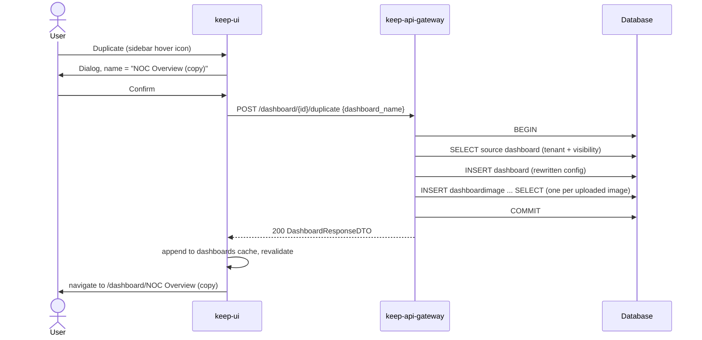

# Duplicate a dashboard

> Services: `keep-api-gateway` (one new endpoint) and `keep-ui` (a sidebar hover action and a dialog).
> No schema change and no `keep-migrations` change.
> Written against `origin/dev`: keep-ui `fbb5610f`, keep-api-gateway `61d5602` (2026-11-12).

## Intro

### The problem

Every new dashboard in Keep starts empty. "Add Dashboard" in the sidebar opens a blank page named
"My Dashboard", and the user builds it widget by widget: pick the preset, the panel type, thresholds,
count-by, columns and colors for each widget, drag and size it into place, then set the background
and spacing.

Teams often want a dashboard that is close to one they already have: the same NOC layout for another
team, the same widgets pointed at a different preset, or a version to try changes on without touching
the one on the wall display. Today the only way to get one is to rebuild it by hand and copy every
setting across, which is slow and easy to get wrong.

What's asked for: a **Duplicate** action that makes a full, independent copy of an existing dashboard
under a new name. The user can then change the copy freely without touching the original.

### Why we got this assignment

A Keep user raised it as a feature request. They want to start new dashboards from an existing one
instead of from a blank page, so dashboards are easier and faster to build. No deadline or rollout is
tied to it.

## Requirements

### Functional requirements

**Entry point**

1. Hovering an entry in the sidebar's Dashboards list shows a copy icon next to the existing delete
   icon. It looks like the delete icon (gray, visible only on hover) and turns orange under the
   pointer, with a "Duplicate" tooltip. It works for any dashboard in the list, open or not.
2. Nothing is added to the dashboard page itself. Duplicating is an occasional action, so it must not
   add visual weight to the screen teams keep open.

**Dialog**

3. Clicking the icon opens a "Duplicate dashboard" dialog with one **Name** field, pre-filled with
   `<source name> (copy)`. If that name is taken, it uses `<source name> (copy 2)`, then `(copy 3)`,
   and so on. The check ignores case, the same way "Add Dashboard" picks a free name today.
4. The dialog says what gets copied: widgets, layout, appearance and uploaded images.
5. The name is checked as the user types. The **Duplicate** button stays disabled while the trimmed
   name is empty or matches an existing dashboard name (case ignored), and a name clash shows
   "A dashboard with this name already exists" under the field.
6. Enter submits the dialog. Escape or Cancel closes it without creating anything.
7. While the request is running, the button shows a spinner and cannot be clicked again.
8. Only the saved version is copied. If the dashboard being copied is open with unsaved edits, the
   dialog adds the line "Unsaved changes aren't included in the copy."

**Result**

9. On success the copy is saved and the sidebar list updates without a page reload. The user is taken
   to `/dashboard/<new name>` in view mode and sees a "Dashboard duplicated" toast.
10. If the user is editing a dashboard with unsaved changes, the existing unsaved-changes prompt
    appears before leaving. If they choose to stay, the copy still exists and is listed in the
    sidebar.
11. The copy has the source's saved `layout`, `widget_data` and `appearance`, so it has the same
    widgets with the same settings, positions, sizes, background and density. Widgets that point at
    presets, metrics, Grafana URLs, image URLs or HTML point at the same things as in the original.
12. Uploaded images (IMAGE widgets with `source: "upload"`) are copied. The new dashboard gets its own
    copy of each image, and its widgets point at the copies.
13. The two dashboards are independent. Editing, renaming or deleting either one never changes the
    other, and that includes their uploaded images.
14. The copy's metadata: `dashboard_name` is the chosen name. `created_by` and `updated_by` are the
    user who duplicated it. `created_at` and `updated_at` are the time of the copy. `is_private` is
    taken from the source, so a copy can never be more visible than its original.
15. The copy is created in the tenant the user is working in. The source must be a dashboard the user
    can see in that tenant.

**Errors**

16. If the name was taken between opening the dialog and submitting it, the gateway returns **409**.
    The dialog stays open, shows "A dashboard with this name already exists", and nothing is created.
17. If the source dashboard was deleted in the meantime, the gateway returns **404**. The dialog shows
    "This dashboard no longer exists" and the sidebar list refreshes.
18. If the user lacks `write:dashboards`, or the deployment is read-only, an error toast appears
    through the existing `showErrorToast` and nothing is created.
19. A failure at any step leaves nothing behind: no dashboard row and no image rows.

### Non-functional requirements

- **Atomic.** The new dashboard row and its image copies are written in one database transaction.
  They commit together or not at all.
- **Performance.** The browser makes one HTTP request. Image bytes are copied inside the database and
  never pass through the gateway's memory or the browser. Proposed target: under 1 s p95 for a
  dashboard with up to 10 uploaded images (each at most 5 MB, per `KEEP_DASHBOARD_IMAGE_MAX_BYTES`).
- **Storage.** Each copy stores its own copy of the uploaded images, so a duplicate adds at most
  (uploaded images × 5 MB). No new per-tenant cap is added, which matches the image widget decision of
  2026-09-24 not to cap total bytes per tenant. The 20-per-tenant cap on pending uploads does not
  apply, because the copies belong to the new dashboard from the moment they are written and are
  never pending.
- **Security.** The endpoint requires `write:dashboards`, the same scope as create. Finding the source
  is limited to the caller's tenant and uses the same visibility rule as `get_dashboards`
  (`is_private = false`, or created by the caller). Image bytes are copied unchanged. The copy is
  served with the same headers as the original (`Content-Disposition: attachment`,
  `Cross-Origin-Resource-Policy`), and the UI still shows uploads as `data:` URLs, so the copy is
  exactly as safe as the original that is already being served.
- **Compatibility.** The endpoint is new and the existing endpoints don't change. No migration is
  needed. The image copy uses `INSERT … SELECT`, which works on both PostgreSQL and MySQL. The UI
  depends on the new endpoint, so the **gateway must be deployed before the UI**. Prod images are
  built from `dev`, so merge the gateway PR first.
- **Observability.**
  - UI: record a `duplicate_dashboard` action (latency) and `recordError("duplicate_dashboard")` through
    the existing RUM metrics. The label must be added to `ACTION_LABELS` in `src/metrics/labels.ts`,
    because unknown labels are rejected.
  - Gateway: one info log per duplicate with `tenant_id`, `source_dashboard_id`, `new_dashboard_id`
    and `copied_images`.
- **Testing.**
  - Gateway pytest:
    - happy path, with image copies pointing at the new dashboard and the config rewritten
    - deleting the source keeps the copy's images
    - 409 on a taken name
    - 404 for another tenant's dashboard and for one that is not visible
    - rollback when an image copy fails
  - UI Jest/RTL:
    - default-name generation
    - name clash and empty name
    - submit and navigation
    - 404/409 handling
  - A live browser check of the full flow on a local stack (sidebar hover, dialog, name clash, copy
    opened with its images, unsaved-changes note). An e2e-suite case in
    `e2e/specs/10-create-dashboard.spec.ts` is a follow-up.

## Proposed Implementation



### 1. Where the copy is made

**Option A: In the browser, using today's API**
The UI already has every dashboard's config from `GET /dashboard`. For each uploaded image it would
download the bytes (`GET /dashboard-images/{id}`), upload them again as a new pending image
(`POST /dashboard-images`), swap in the new `imageId`, and finally `POST /dashboard` with the new name.

Trade-offs:
- Pros: no gateway change, so it ships in one repo.
- Cons:
  - Two requests per uploaded image plus one more, and up to 5 MB per image downloaded and uploaded
    again through the browser.
  - Not atomic. A failure halfway leaves pending uploads behind (they are only cleaned up on that
    tenant's next upload) and no dashboard.
  - The 20-per-tenant pending cap blocks dashboards with many uploaded images, or any tenant that
    already has uploads pending.
  - The logic lives only in the UI, so API users can't duplicate.
- Complexity / risk / cost / time: low code cost, but the failure modes are real and land on the user.

**Option B: A gateway endpoint, `POST /dashboard/{dashboard_id}/duplicate`**
One request. The gateway reads the source, writes the new dashboard and copies its images in a single
database transaction.

Trade-offs:
- Pros:
  - Atomic, and image bytes never leave the database.
  - One request however many images there are.
  - Available to API and automation users.
  - Naming and visibility are enforced in one place.
- Cons: touches two repos, and the gateway must be deployed before the UI.
- Complexity / risk / cost / time: one route, one repository function and one image-copy helper,
  plus tests. Small.

| | A: browser | B: gateway endpoint |
|---|---|---|
| Requests | 2 × images + 1 | 1 |
| Atomic | No | Yes |
| Image bytes travel | DB → gateway → browser → gateway → DB | Stay in the DB |
| Repos touched | keep-ui | keep-api-gateway + keep-ui |
| Blocked by pending cap | Yes | No |

**Recommendation:** Option B. Option A's problems (no atomicity, orphaned uploads, the pending cap)
are exactly the cases users notice, and B avoids all of them for the price of one small endpoint.

### 2. Uploaded images

Background: each `dashboardimage` row has exactly one owner (`dashboard_id`). A save that references
an image owned by another dashboard is rejected with 400 (`check_dashboard_image_references`), and
deleting a dashboard deletes its images. A copy therefore cannot reuse the source's image ids.

**Option A: Copy each image row**
For each uploaded-image id the source's config references (`referenced_image_ids`), insert a new row
with a new id, owned by the new dashboard, with the same `name`, `content_type`, `size_bytes` and
`image_blob`. Use `INSERT … SELECT` so the bytes are copied inside the database. Then replace each
old `imageId` with its new one in the copied config.

Trade-offs:
- Pros: the one-owner rule is untouched. No schema change, and the claim, release and delete code
  stays as it is. The two dashboards are fully independent.
- Cons: the bytes are stored twice (at most 5 MB per image).
- Complexity / risk / cost / time: one helper next to `sync_dashboard_images`. Low risk.

**Option B: Share images between dashboards (join table or reference count)**

Trade-offs:
- Pros: no extra storage.
- Cons:
  - Needs a schema change in `keep-migrations`.
  - The claim, release and delete logic that shipped with the image widget would have to be
    rewritten.
  - Deleting a dashboard would first have to check whether another dashboard still uses each image.
- Complexity / risk / cost / time: a migration plus changes to a recently shipped invariant. Medium
  to high risk for a small storage saving.

**Recommendation:** Option A. Duplicated images are capped at 5 MB each and few per dashboard, so the
extra storage is small. Keeping the one-owner rule means nothing already shipped has to change.

### 3. API contract

**Option A: A dedicated duplicate endpoint**

```
POST /dashboard/{dashboard_id}/duplicate
Scope: write:dashboards
Body:  { "dashboard_name": "NOC Overview (copy)" }
```

| Status | When | Body |
|---|---|---|
| 200 | Copy created | `DashboardResponseDTO`, same as `POST /dashboard` |
| 400 | The source references an image it doesn't own (inconsistent data) | `{message, invalid_image_ids}`, same as the save path |
| 403 | Missing `write:dashboards` | standard |
| 404 | Source missing, in another tenant, or not visible to the caller | `{"detail": "Dashboard not found"}` |
| 409 | `dashboard_name` already exists in the tenant | `{"detail": "A dashboard with this name already exists"}` |
| 422 | `dashboard_name` missing or empty after trimming | standard validation error |

The client sends only the name. The server copies the **saved** config, so a stale or tampered
client copy can't get in. The route path has two segments, so it can't collide with `/metric-widgets`
or `/ticket-count`. Image routes are mounted separately under `/dashboard-images`.

Trade-offs:
- Pros: one clear job, and validation and errors stay separate from create.
- Cons: one more route to document.

**Recommendation:** Option A, the only option considered viable. The other choice would be a
`copy_from` field on `POST /dashboard`, which mixes two different image rules in one handler: create
claims pending uploads, while copy writes images that are owned from the start. It would make the
create path harder to reason about.

### 4. Gateway implementation

**Option A: A repository function plus an image-copy helper, in the existing modules**

In `src/repositories/dashboard_images.py`, next to `sync_dashboard_images`:

```python
def copy_dashboard_images(
    session: Session,
    tenant_id: str,
    source_dashboard_id: str,
    new_dashboard_id: str,
    id_map: dict[str, str],
    created_by: str,
) -> None:
    """Copy the source dashboard's images under new ids owned by the new dashboard.

    Bytes are copied with INSERT ... SELECT and never loaded into Python. Raises
    DashboardImageReferenceError for an id the source does not own.
    """
    for old_id, new_id in id_map.items():
        result = session.execute(
            insert(DashboardImage).from_select(
                [...columns...],
                select(
                    literal(new_id), DashboardImage.tenant_id, literal(new_dashboard_id),
                    DashboardImage.name, DashboardImage.content_type,
                    DashboardImage.size_bytes, DashboardImage.image_blob,
                    literal(created_by), func.now(),
                ).where(
                    DashboardImage.tenant_id == tenant_id,
                    DashboardImage.id == old_id,
                    DashboardImage.dashboard_id == source_dashboard_id,
                ),
            )
        )
        if result.rowcount != 1:
            raise DashboardImageReferenceError([old_id])
```

In `src/repositories/db.py`, a `duplicate_dashboard(tenant_id, source_id, new_name, created_by)`
function that, inside one `Session`:

1. Loads the source by `tenant_id` + `id` with the visibility filter from `get_dashboards`. If it
   isn't found, returns `None`.
2. Parses `dashboard_config` when Postgres returns it as a string, as `get_dashboards` already does,
   and deep-copies it.
3. Builds `id_map = {old: str(uuid4())}` from `referenced_image_ids(config)` and replaces `imageId`
   in each copied IMAGE widget.
4. Adds the new `Dashboard` with the rewritten config, `is_private` taken from the source, and
   `created_by`/`updated_by` set to the caller, then calls `flush()`. On `IntegrityError` from
   `unique_dashboard_name_per_tenant` it raises `DashboardNameTakenError`.
5. Calls `copy_dashboard_images(...)`. The new dashboard row must already be flushed because of the
   foreign key.
6. Commits, refreshes, and returns the new dashboard.

In `src/routes/dashboard.py`:
- a `DashboardDuplicateDTO` with a Pydantic v1 validator that trims the name and rejects an empty one
- a `POST /{dashboard_id}/duplicate` handler that maps the outcomes to HTTP responses:
  - `None` → 404
  - `DashboardNameTakenError` → 409
  - `DashboardImageReferenceError` → the existing `_invalid_images_response`

Trade-offs:
- Pros: follows the module layout the image widget already uses. Everything shares one session, so
  one transaction covers it.
- Cons: `db.py` grows by one more function.

**Recommendation:** Option A, the only option considered viable. A separate service layer would be a
new pattern for one function.

### 5. UI entry point

**Option A: Sidebar hover icon only**
A copy icon on each sidebar dashboard entry, shown on hover next to the delete icon and styled the
same way.

Trade-offs:
- Pros:
  - Adds nothing to the dashboard screen, which teams often leave open on a wall display.
  - Sits where dashboards are already added and deleted.
  - Any dashboard can be copied without opening it.
- Cons: less discoverable than a visible button. The tooltip and the spot next to delete make up for
  most of that.
- Complexity / risk / cost / time: `LinkWithIcon` is shared with other sidebar links, so it gains one
  optional prop. Links that don't pass it don't change.

**Option B: Header button plus the sidebar icon**
A visible Duplicate button next to Edit on the dashboard page, in addition to the sidebar icon.

Trade-offs:
- Pros: the most discoverable option.
- Cons: a permanent button on the most-viewed screen for an action used rarely. It also needs rules
  for edit mode and unsaved drafts.

**Recommendation:** Option A (product decision, 2026-11-16). Duplicating is occasional, so it should
appear only when asked for and not add visual weight to the dashboard screen.

### 6. UI implementation

**Option A: A small feature module used by the sidebar**

- `src/features/dashboard-duplicate/` (FSD feature module, with an `index.ts` barrel):
  - `lib/copy-name.ts`: pure helpers.
    - `defaultCopyName(sourceName, existingNames)` returns `X (copy)`, `X (copy 2)`, and so on,
      ignoring case.
    - `isDashboardNameTaken(name, existingNames)`.
  - `model/useDuplicateDashboard.ts`: calls
    `api.post(`/dashboard/${id}/duplicate`, { dashboard_name })`, appends the result to the
    `useDashboards` cache and revalidates (the same pattern `handleSaveDashboard` uses after a create),
    and records the `duplicate_dashboard` metric.
  - `ui/DuplicateDashboardModal.tsx`: the dialog (name field, validation, loading, 404/409 messages).
    On success it calls `confirmNavigation(() => router.push(`/dashboard/${encodeURIComponent(name)}`))`.
    It shows the "Unsaved changes aren't included" line when two things are true:
    - the source is the open dashboard (the same pathname check `deleteDashboard` already does)
    - `useNavigationGuardStore` holds a blocker. The edit session registers one only while there are
      unsaved changes.
- `src/components/LinkWithIcon.tsx`: an optional `onDuplicate` that renders a copy icon before the
  trash icon. The icon is shown only on hover, uses the same gray as the trash icon and turns orange
  under the pointer. It has a "Duplicate" tooltip and `aria-label="Duplicate <name>"`.
  - `DashboardLink` passes it with `data-cy="nav-link-dashboard-duplicate-<id>"`.
  - `DashboardLinks` holds the dialog state.
- The dashboard page (`[id]/dashboard.tsx`) does not change.
- `src/metrics/labels.ts`: add `"duplicate_dashboard"` to `ACTION_LABELS`.
- "Add Dashboard" and its `generateUniqueName` (`My Dashboard(1)`) stay as they are.

Trade-offs:
- Pros: the dialog, the hook and the naming rules live outside the navbar component and can be
  tested on their own. The naming rules are pure functions.
- Cons: `components/navbar` imports from `features/`, which is the allowed direction in FSD.

**Recommendation:** Option A, the only option considered viable. Putting the dialog in
`app/(keep)/dashboard` would make the sidebar import from a route folder.

## Summary

- **Chosen approach:**
  - A new gateway endpoint, `POST /dashboard/{id}/duplicate`, copies a saved dashboard within the
    tenant in one transaction, including its own copy of each uploaded image.
  - keep-ui adds a copy icon that appears when hovering a dashboard in the sidebar. It opens a dialog
    with the name pre-filled as `<name> (copy)`, then takes the user to the new dashboard. The
    dashboard screen itself doesn't change.
- **Key decisions:**
  - Copy on the server, not in the browser, so the copy is atomic, image bytes stay in the database,
    and the pending-upload cap doesn't apply.
  - Copy image rows rather than share them, so the one-owner rule from the image widget stays as it
    is and no migration is needed.
  - Sidebar hover icon only, with no header button, because duplicating is occasional and shouldn't
    add visual weight to the dashboard screen.
  - Copy the saved version only. The client sends just the new name, and the dialog says when unsaved
    edits are left out.
  - Copy `is_private` from the source, so a copy is never more visible than its original.
  - Deploy order: the gateway before keep-ui.
- **Out of scope / follow-ups:**
  - Copying a dashboard into another tenant or org (export/import), which was decided out of scope.
  - "Save as copy" from edit mode, which would copy unsaved edits. It needs a different contract,
    because the client would send the config.
  - A "copied from" link or lineage field on the copy, which nobody has asked for.
  - Dashboard templates or a starter gallery.
  - `POST /dashboard` returns 500 rather than 409 on a duplicate name today. This is an existing bug
    and should be a separate small fix.
